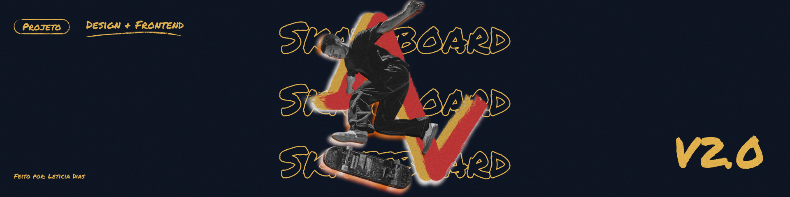
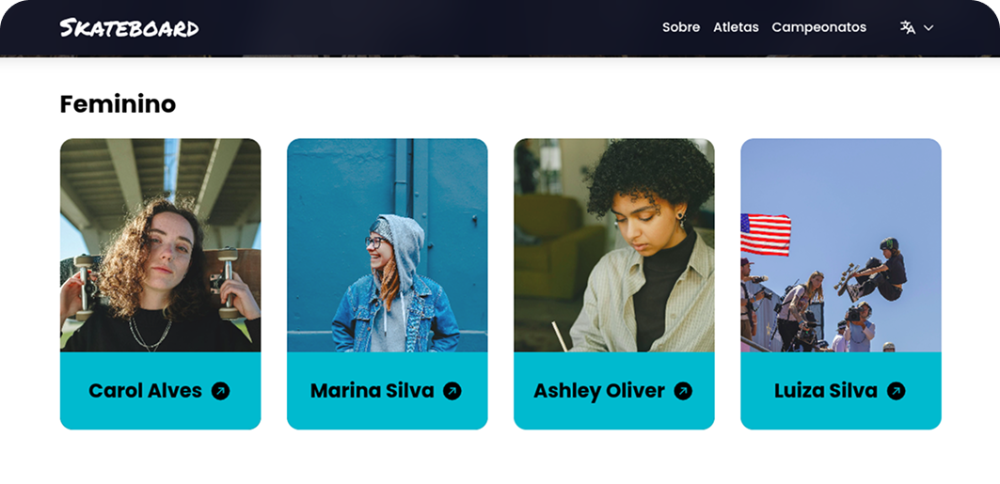
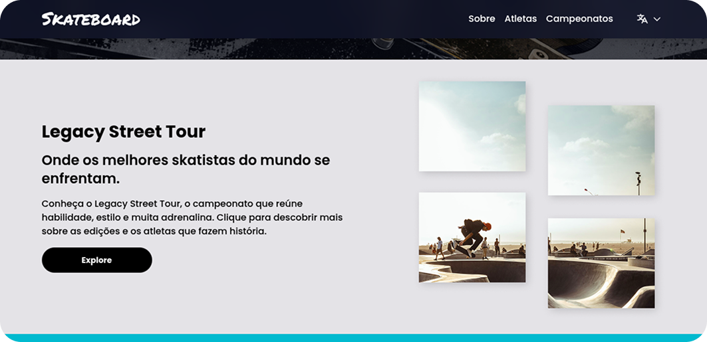
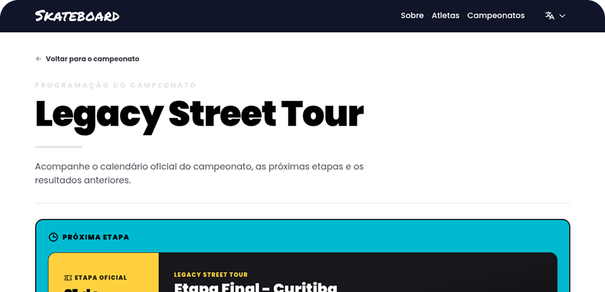
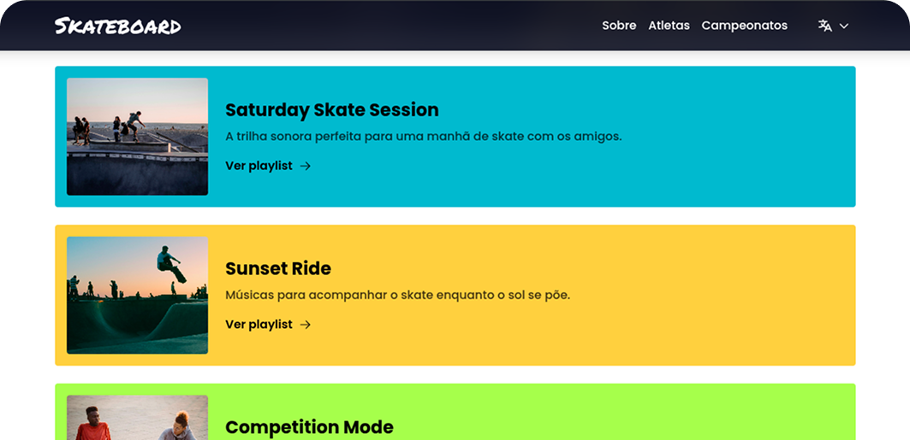

# Skateboard

**Skateboarding in motion.**

Um hub de informações dedicado ao universo do skate.

Atletas, campeonatos, eventos e tudo aquilo que movimenta o esporte em um só lugar.

## Sobre o projeto

**Uma plataforma dedicada ao universo do skate.**

O Skateboard é uma plataforma criada para reunir e organizar informações sobre o universo do skate.

A proposta é oferecer um espaço onde pessoas interessadas pelo esporte possam conhecer atletas, explorar campeonatos, acompanhar eventos e descobrir diferentes aspectos desse cenário.

Mais do que apresentar informações isoladas, o projeto busca conectar diferentes partes do universo do skate em uma experiência simples, intuitiva e acessível.

## Explore a plataforma

**Tudo o que você precisa para acompanhar o skate.**

O Skateboard reúne diferentes áreas para explorar o cenário do esporte, conhecer seus participantes e acompanhar suas competições.

|                                       |       |
| :--------------------------------------------------------------------------------------------------------: | :----------------------------------------------------------------------------------: |
|                                                  Atletas                                                   |                                     Campeonatos                                      |
| Conheça skatistas, explore seus perfis e descubra suas trajetórias, estatísticas, conquistas e resultados. | Explore campeonatos, conheça suas informações e acompanhe rankings e classificações. |

|                                     |                                  |
| :--------------------------------------------------------------------------------------------------: | :-----------------------------------------------------------------------------------------------------: |
|                                               Eventos                                                |                                                Playlists                                                |
| Descubra eventos relacionados ao skate e explore informações sobre suas competições e participantes. | Explore playlists relacionadas ao universo do skate e descubra novas músicas para acompanhar o esporte. |

## Experiência e interface

**Uma experiência pensada para explorar.**

A interface do Skateboard foi desenvolvida para organizar informações de maneira clara e facilitar a navegação entre as diferentes áreas da plataforma.

Sua identidade visual busca inspiração na cultura street e no universo do skate, combinando elementos gráficos, contrastes e uma linguagem visual urbana.

A aplicação também conta com uma interface responsiva e suporte aos idiomas português e inglês, permitindo diferentes formas de acesso e navegação.

## Tecnologias utilizadas

O projeto foi desenvolvido utilizando tecnologias do ecossistema JavaScript e TypeScript, com foco em organização, componentização e manutenção do código.

| Tecnologia   | Utilização                            |
| ------------ | ------------------------------------- |
| React        | Construção da interface               |
| TypeScript   | Tipagem e segurança do código         |
| Vite         | Ferramenta de desenvolvimento e build |
| Tailwind CSS | Estilização da aplicação              |
| React Router | Gerenciamento de rotas e navegação    |
| Motion       | Animações e interações                |
| i18next      | Internacionalização                   |

## Executando o projeto

Para executar o Skateboard localmente, você precisará ter o Node.js e o npm instalados.

**1. Clone o repositório**

```bash
git clone https://github.com/leticiadia/skateboard.git
```

**2. Acesse a pasta do projeto**

```bash
cd skateboard
```

**3. Instale as dependências**

```bash
npm install
```

**4. Inicie o servidor de desenvolvimento**

```bash
npm run dev
```

Após iniciar o servidor, acesse o endereço disponibilizado pelo Vite no terminal.

### Observações

Atualmente, o Skateboard utiliza dados mockados para apresentar as informações da plataforma. As funcionalidades e interfaces estão estruturadas no frontend, sem integração com uma API ou banco de dados nesta versão.

**👩‍💻 Feito por Leticia Dias 💙**
